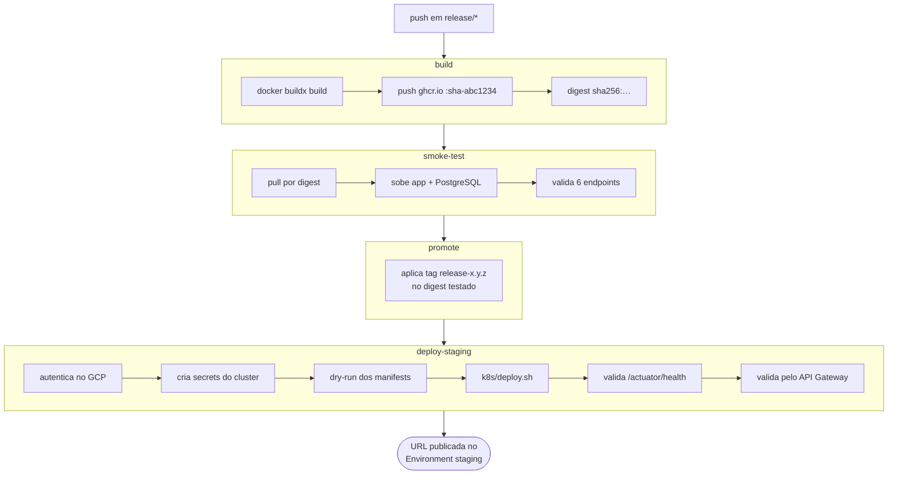

# Entrega Contínua (CD)

Como um commit numa branch de release vira uma aplicação no ar em staging, e como
a tag dessa versão a promove para produção.

- Workflows: [`cd-staging.yml`](../.github/workflows/cd-staging.yml) · [`cd-production.yml`](../.github/workflows/cd-production.yml)
- Registry: GitHub Container Registry (`ghcr.io/iuriian/tech-challenge`)
- Destinos: cluster **GKE**, namespaces `tech-challenge-staging` e `tech-challenge-production`
- Infraestrutura: [`tech-challenge-infra-k8s`](https://github.com/iuriian/tech-challenge-infra-k8s) (repo separado) · Manifests: [`k8s/`](../k8s/)

---

## 1. Quando roda

```yaml
on:
  push:
    branches: ["release/**"]
  workflow_dispatch:

# cd-production.yml
on:
  push:
    tags: ["v*.*.*"]
  workflow_dispatch:

concurrency:
  group: cd-staging
  cancel-in-progress: false
```

Todo push numa branch `release/*` faz o deploy em staging. Também dá para disparar
manualmente pela aba Actions.

O `concurrency` com `cancel-in-progress: false` enfileira execuções em vez de
cancelá-las: um deploy no meio de um `kubectl apply` cancelado deixaria o cluster
num estado indefinido.

---

## 2. Visão geral



O encadeamento importa: a tag legível (`release-1.0.0`) só é aplicada **depois** que
o smoke test passou. Uma imagem que não sobe nunca recebe um nome bonito.

---

## 3. Job `build`

1. `docker/setup-buildx-action` e login no GHCR com o `GITHUB_TOKEN`.
2. **Normaliza o nome da imagem** para minúsculas — o GHCR não aceita maiúsculas, e
   `github.repository` preserva o caso do dono do repositório.
3. `docker/metadata-action` com `tags: type=sha,format=short` → `:sha-816c3ff`.
4. `docker/build-push-action` com cache do próprio Actions
   (`cache-from/to: type=gha, mode=max`), o que reaproveita as camadas do Gradle
   entre execuções.
5. Exporta o **digest**: `ghcr.io/iuriian/tech-challenge@sha256:…`

A partir daqui todos os jobs falam por digest, não por tag. Digest é imutável: o que
o smoke test aprovou é exatamente o que o Kubernetes vai baixar.

O build usa o [`Dockerfile`](../Dockerfile) multi-stage: JDK 21 compila o boot jar
(`bootJar -x test`) e extrai as camadas do Spring Boot; a imagem final tem só o JRE
21 e roda com usuário não-root `spring`. Os testes **não** rodam aqui — quem testa é
a CI, no PR.

---

## 4. Job `smoke-test`

Usa [`.github/actions/smoke-test`](../.github/actions/smoke-test/action.yml): baixa a
imagem pelo digest, sobe um PostgreSQL 16 descartável numa rede Docker própria, sobe
o container da aplicação apontando para ele e espera o `/actuator/health` responder
(até 180s). No boot, o Flyway aplica as 12 migrations em `db/migration` — ou seja, o
smoke test também valida as migrations.

Endpoints verificados:

```
/actuator/health
/actuator/health/liveness
/actuator/health/readiness
/actuator/info
/v3/api-docs
/swagger-ui/index.html
```

Se algum falhar, o job imprime `docker logs` do container e reprova. A prontidão é
checada de fora (`curl` do runner) e não por `HEALTHCHECK` do Docker, porque a imagem
runtime não tem `curl` instalado.

---

## 5. Job `promote`

Aplica as tags legíveis ao digest já testado, sem reconstruir nada:

```bash
docker buildx imagetools create --tag <tag> <digest>
```

Tags configuradas:

| Regra | Resultado num push em `release/1.0.0` |
|---|---|
| `type=ref,event=branch` | `:release-1.0.0` |
| `type=raw,value=latest,enable={{is_default_branch}}` | *não aplicada* — a branch não é a default |

> A tag `latest` nunca é produzida por este workflow, já que ele só roda em
> `release/**` e a branch default é `main`. Se `latest` for desejada para staging,
> troque o `enable` por uma condição explícita.

---

## 6. Job `deploy-staging`

Roda no Environment `staging` do GitHub, e é ele quem publica a URL final na
interface do Actions.

| Passo | O que faz |
|---|---|
| Check environment configuration | Falha cedo, com mensagem clara, se faltar secret ou variable |
| Setup Google Cloud | `google-github-actions/auth` com `GCP_SA_KEY` |
| Configure kubectl | `gcloud container clusters get-credentials` + `gke-gcloud-auth-plugin` |
| Ensure namespace | Cria `tech-challenge-staging` se não existir |
| Create cluster secrets | Lê a senha do **Google Secret Manager** e cria `db-credentials` |
| Create GHCR pull secret | Cria `ghcr-creds` para o cluster puxar a imagem privada |
| Validate manifests | `kubectl apply --dry-run=server` — valida contra o cluster real, sem aplicar |
| Deploy | `./k8s/deploy.sh <digest> staging <namespace>` |
| Verify and expose URL | Espera o IP externo do Service, testa `/actuator/health` e escreve o resumo |
| Smoke test pelo API Gateway | Só se a variable `API_GATEWAY_URL` existir: testa o health pela borda pública e exige `401` em `/api/v2/clientes` sem token. Um `200` ali significaria api-config publicada sem a validação de JWT |
| Debug (`if: failure()`) | Imprime pods, services, PVCs, eventos e logs de todos os containers |

**Sobre as senhas.** Elas não estão em nenhum lugar do repositório nem nos secrets do
GitHub: o Terraform do repositório de infra gera senhas aleatórias e as grava no
Secret Manager; o pipeline as lê em runtime e chama `::add-mask::` antes de usá-las,
porque valores lidos em tempo de execução não são mascarados automaticamente pelo
GitHub.

### O que o `k8s/deploy.sh` faz

A ordem existe por um motivo, e é o que o script encapsula:

1. **Secrets** — apenas exige que `db-credentials` já exista no namespace e aborta se
   não existir. Um padrão de desenvolvimento nunca casaria com a senha do usuário no
   Cloud SQL, e o erro só apareceria depois, como `CrashLoopBackOff`. No pipeline o
   secret vem do Secret Manager. O checksum dele entra no pod template, para que uma
   senha corrigida force um ReplicaSet novo em vez de um apply no-op.
2. **ConfigMap `app-config`** — recebe `DB_HOST` (IP privado do Cloud SQL),
   `DB_SSLMODE`, issuer e audience dos tokens no lugar dos placeholders.
3. **Aplicação**, com o digest da imagem e o `APP_LB_IP` no `loadBalancerIP` do
   Service — é o endereço que o API Gateway usa como backend, e sem ele o GKE
   sortearia um IP novo a cada recriação do Service. Sem a variable definida, o
   script remove a linha e avisa. Emissor de tokens e banco são ambos externos ao
   cluster e chegam pelo `app-config`, sem Service nem descoberta de IP. O
   initContainer `wait-for-db` espera o `pg_isready` no `DB_HOST`.
4. **HPA** por último — aplicado antes, o alvo não existiria.

Não há passo de PostgreSQL: o banco é um Cloud SQL externo, provisionado pelo
repositório `tech-challenge-database`. O job de deploy resolve o IP privado com
`gcloud sql instances describe` e aborta se a instância estiver desligada. A pasta
`k8s/postgres/` e o ConfigMap `postgres-initdb` servem apenas ao ambiente com kind.

O Deployment da aplicação usa `maxSurge: 0`: o pod antigo cai antes do novo subir.
Num único nó `e2-medium` não há CPU para dois pods simultâneos. O custo é uma breve
indisponibilidade a cada deploy, aceitável em staging.

---

## 7. Infraestrutura

A fronteira entre Terraform e Kubernetes é deliberada: **Terraform cuida do que dura,
o pipeline cuida do que muda a cada commit.** Ela separa também os repositórios — o
Terraform vive em
[`tech-challenge-infra-k8s`](https://github.com/iuriian/tech-challenge-infra-k8s),
com pipeline e state próprios.

| Terraform (repo de infra) | Pipeline + `k8s/` (este repo) |
|---|---|
| APIs do GCP, VPC e subnet, cluster GKE, node pool com autoscaling | Deployments, Services, ConfigMaps |
| Service account do CI e papéis IAM | Secrets do cluster (lidos do Secret Manager) |
| Secrets do Secret Manager e senhas aleatórias | Namespace e ordem de aplicação (`deploy.sh`) |

O provisionamento roda lá, não aqui: um Pull Request no repo de infra executa
`terraform plan`, e o merge na main executa o `apply`. Nenhum workflow deste
repositório chama Terraform — o `cd-staging.yml` apenas consome o cluster e os
segredos que já existem.

O que atravessa a fronteira são três valores de identificação, lidos com
`terraform output github_environment_variables` e cadastrados no Environment deste
repositório (`GCP_PROJECT_ID`, `GKE_CLUSTER`, `GKE_ZONE`), mais a chave da service
account no secret `GCP_SA_KEY`. Trocar o nome ou a zona do cluster sem atualizar os
secrets quebra o passo de `get-credentials`, porque este pipeline não tem outra forma
de descobrir o destino. Detalhes em
[README do repo de infra](https://github.com/iuriian/tech-challenge-infra-k8s#readme).

---

## 8. Configuração necessária no GitHub

Settings → Environments → **staging**

| Tipo | Nome | Obrigatório | Descrição |
|---|---|---|---|
| Secret | `GCP_SA_KEY` | sim | JSON da service account do CI |
| Secret | `GHCR_PAT` | recomendado | PAT com `read:packages`. Sem ele o `GITHUB_TOKEN` é usado e **expira ao fim do job** — pods que reiniciarem depois falham com `ImagePullBackOff` |
| Secret | `GCP_PROJECT_ID` | sim | Projeto no GCP |
| Secret | `GKE_CLUSTER` | sim | Nome do cluster (também prefixa os secrets no Secret Manager) |
| Secret | `GKE_ZONE` | sim | Zona do cluster |
| Variable | `KUBE_NAMESPACE` | não | Padrão: `tech-challenge-staging` |
| Variable | `AUTH_ISSUER_URI` | sim | Emissor dos tokens; o deploy aborta se estiver vazia |
| Variable | `APP_LB_IP` | sim | IP reservado do Service (`terraform output -raw app_lb_ip`). Sem ela o Service recebe IP efêmero e o API Gateway segue apontando para o endereço antigo |
| Variable | `API_GATEWAY_URL` | não | URL do gateway. Quando presente, habilita o smoke test pela borda |
| Variable | `DB_USER` | não | Padrão: `oficina_app` |

Settings → Environments → **production**

| Tipo | Nome | Obrigatório | Descrição |
|---|---|---|---|
| Proteção | **Required reviewers** | recomendado | É daqui que vem a aprovação manual: o workflow não a implementa |
| Secret | `GCP_SA_KEY` · `GCP_PROJECT_ID` · `GKE_CLUSTER` · `GKE_ZONE` | sim | Mesmo papel que em staging, apontando para o ambiente de produção |
| Secret | `GHCR_PAT` | **sim** | Diferente de staging: aqui a falta dele é erro, não aviso |
| Variable | `AUTH_ISSUER_URI` | sim | Emissor dos tokens de produção |
| Variable | `APP_LB_IP` · `API_GATEWAY_URL` | sim · não | Mesmo papel que em staging, com os outputs do Terraform do ambiente de produção |
| Variable | `KUBE_NAMESPACE` | não | Padrão: `tech-challenge-production` |
| Variable | `CLOUDSQL_INSTANCE` | não | Padrão: `<GKE_CLUSTER>-pg` |
| Variable | `DB_PASSWORD_SECRET` | não | Padrão: `<GKE_CLUSTER>-db-password` |
| Variable | `DB_USER` | não | Padrão: `oficina_app` |

---

## 9. Ambientes

| Ambiente | Como sobe | Onde | Banco |
|---|---|---|---|
| Local (dev) | `docker-compose up -d db` + `./gradlew bootRun` | máquina | container descartável |
| Local (stack) | `docker-compose --profile full up -d` | máquina | container + volume |
| Local (k8s) | `./kind/deploy-local.sh` | cluster kind, **mesmos manifests do GKE** | PVC do kind |
| Staging | push em `release/*` | GKE | Cloud SQL externo (repo `tech-challenge-database`) |
| Produção | tag `vX.Y.Z` em `main` | GKE | Cloud SQL externo (instância própria) |

O ambiente `kind` é o ensaio: valida os manifests de `k8s/` sem gastar recurso na
nuvem. Veja [`kind/README.md`](../kind/README.md).

---

## 10. Pipeline de produção

Produção **não builda imagem**. Ela promove para o cluster o digest exato que o CD
de staging buildou, passou no smoke test e colocou no ar em homologação. Rebuildar a
partir da tag geraria um digest diferente do validado, e a promessa "o que foi
testado é o que sobe" se perderia.

O elo entre o git e o registry é a versão:

```
tag git v1.1.0  →  ghcr.io/<repo>:release-1.1.0  →  digest validado
```

A tag `release-1.1.0` é a que o job `promote` aplicou sobre o digest testado quando
houve push em `release/1.1.0`. Se ela não existir no GHCR, o job falha dizendo que
aquela versão nunca passou por homologação — **não há caminho para produção que pule
o staging**.

| Job | O que faz |
|---|---|
| `resolve` | valida a versão em MAJOR.MINOR.PATCH, confere que o commit da tag está em `main` e resolve o digest |
| `smoke-test` | reusa a mesma composite action do staging contra o digest resolvido |
| `deploy-production` | `environment: production`, Cloud SQL, secrets, deploy, verificação e rollback |
| `tag-released` | marca o digest com `:production` e `:vX.Y.Z` no registry |

Quatro diferenças deliberadas em relação ao staging:

1. **Guarda de `main`** — `git branch -r --contains` rejeita tag criada fora de `main`.
2. **`GHCR_PAT` é obrigatório** — em staging a falta dele é aviso; aqui é erro. O
   `GITHUB_TOKEN` expira ao fim do job e todo pod que reiniciar depois cai em
   `ImagePullBackOff`.
3. **Rollback automático** — a imagem corrente é gravada antes do deploy; se qualquer
   passo falhar, o Deployment volta para ela.
4. **Instância e secret parametrizáveis** — `vars.CLOUDSQL_INSTANCE` e
   `vars.DB_PASSWORD_SECRET`, com fallback para `<GKE_CLUSTER>-pg` e
   `<GKE_CLUSTER>-db-password`.

A aprovação manual não está no workflow: ela vem dos *required reviewers* do
Environment `production`, configurados em Settings > Environments.

---

## 11. Rollback

Não há rollback automático. Se o deploy subir algo quebrado:

```bash
# 1. mais rápido: volta o Deployment para a revisão anterior
kubectl rollout undo deployment/app -n tech-challenge-staging
kubectl rollout status deployment/app -n tech-challenge-staging

# 2. voltar para um digest específico já testado
kubectl set image deployment/app app=ghcr.io/iuriian/tech-challenge@sha256:<digest> \
  -n tech-challenge-staging

# 3. ver o histórico de revisões
kubectl rollout history deployment/app -n tech-challenge-staging
```

Os digests de cada execução ficam no log do job `build` e na aba Packages do
repositório.

Atenção: rollback da aplicação **não desfaz migrations**. O Flyway só avança. Se a
release aplicou uma migration destrutiva, voltar a imagem não resolve — por isso
migrations devem ser sempre compatíveis com a versão anterior da aplicação.

---

## 12. Quando o deploy falha

| Sintoma | Causa provável | O que fazer |
|---|---|---|
| `Configuracao ausente no Environment 'staging'` | Falta secret ou variable | Conferir a tabela da seção 8 |
| `ImagePullBackOff` | `ghcr-creds` com token expirado | Configurar `GHCR_PAT` e rodar o deploy de novo |
| `O Service app nao recebeu IP externo` | Cota de LoadBalancer ou zona sem capacidade | `kubectl get svc -n <ns>` e checar cota do projeto |
| Pod `Pending` | Nó sem CPU disponível | Aumentar `max_node_count` no repo de infra ou reduzir `requests` |
| `401` com token válido | `AUTH_ISSUER_URI` ou `AUTH_AUDIENCE` divergentes do emissor | Conferir o `app-config` do namespace |
| `502` pelo gateway, `200` pelo IP do Service | Backend da api-config com o endereço antigo do LB | Comparar `terraform output -raw api_gateway_backend_host` com o IP do Service e reaplicar o Terraform de infra |
| `401` do gateway em rota aberta | Path não declarado na spec do gateway, ou declarado sem `security: []` | Ajustar `openapi.yaml.tftpl` no repo de infra |
| App sobe e cai em loop | Falha de migration ou de conexão com o banco | O passo Debug já imprime `logs -c app --previous` |

O passo **Debug** só roda em falha e imprime pods, services, PVCs, eventos do
namespace, logs do init container `wait-for-db` e do container da aplicação
(inclusive a execução anterior). Comece por ele.

---

## 13. Limitações e próximos passos

- **O pipeline de produção nunca executou.** O `cd-production.yml` existe e está
  lintado, mas autenticação no GCP, lookup do Cloud SQL e rollout só se provam na
  primeira execução real. Dispare a primeira por `workflow_dispatch`, com uma versão
  já validada, em vez de descobrir na primeira tag.
- **O HPA é o mesmo nos dois ambientes.** `k8s/app/hpa.yaml` está fixo em 1 a 3
  réplicas, dimensionamento pensado para staging.
- **Sem aprovação manual.** O Environment `staging` não tem *required reviewers*;
  qualquer push em `release/*` sobe direto.
- **A imagem é construída sem rodar testes.** O `Dockerfile` usa `bootJar -x test` e o
  CD não executa a suíte. Um push direto em `release/*` (sem passar por PR) chega em
  staging sem nenhum gate de qualidade.
- **Sem varredura da imagem.** Não há Trivy/Grype no pipeline.
- **HPA sem teste de carga.** O autoscaler está configurado (1 a 3 réplicas, 70% de
  CPU), mas nada no pipeline exercita o escalonamento.
