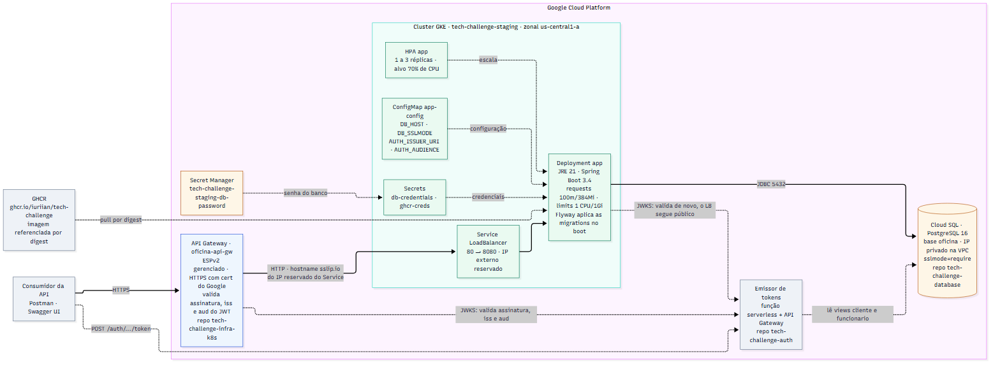
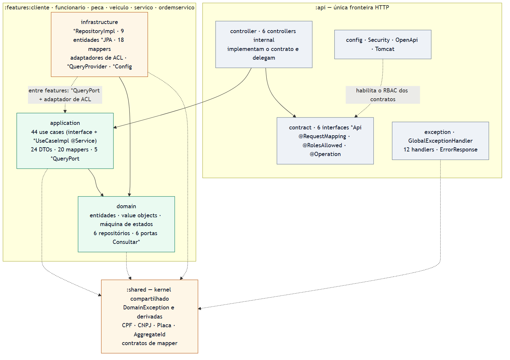

# Solução, Arquitetura e Execução

Documento de entrega do Tech Challenge — FIAP PosTech, Software Architecture, Grupo 89.
Cobre a descrição da solução, os objetivos da fase, o desenho da arquitetura e as
instruções de execução local, deploy em Kubernetes e a fronteira com a infraestrutura
provisionada por Terraform em repositório separado.

| | |
|---|---|
| Repositório | <https://github.com/iuriian/tech-challenge> |
| Collection das APIs | [Postman](TechChallengeAPI%20.postman_collection.json) · Swagger UI em `/swagger-ui/index.html` |
| Vídeo demonstrativo | *(preencher com o link do YouTube/Vimeo, até 15 min)* |
| Ambiente de staging | *(preencher com a URL publicada pelo pipeline)* |

---

## 1. Descrição da solução

O sistema atende uma **oficina mecânica** e cobre o ciclo completo do atendimento:
do cadastro do cliente e do veículo até a entrega do serviço executado.

O núcleo do domínio é a **Ordem de Serviço**. Ela nasce quando o veículo é recebido,
passa por diagnóstico, recebe um **orçamento** montado a partir do catálogo de
serviços e das peças em estoque, aguarda a aprovação do cliente e só então entra em
execução. Cada transição é validada por uma máquina de estados no próprio domínio —
não é possível pular etapas nem alterar uma ordem já entregue.

```
RECEBIDA → EM_DIAGNOSTICO → AGUARDANDO_APROVACAO → EM_EXECUCAO → FINALIZADA → ENTREGUE
                                     ↓
                                CANCELADA
```

Além do fluxo da ordem, o sistema mantém:

| Recurso | O que resolve |
|---|---|
| **Clientes** | Cadastro com CPF/CNPJ validado, endereço e contatos |
| **Veículos** | Frota vinculada ao cliente, busca por placa e por motorista |
| **Funcionários** | Equipe da oficina com cargo (mecânico, atendente, admin) |
| **Peças** | Catálogo com controle de estoque: retirada e reposição com validação de saldo |
| **Catálogo de serviços** | Serviços oferecidos, com preço, tempo estimado e ativação/desativação |
| **Ordens de serviço** | Ciclo completo, orçamento calculado e métrica de tempo médio de execução |

O acesso é controlado por **perfis** vindos do claim `roles` do JWT: `ADMIN`,
`ATENDENTE`, `MECANICO` e `CLIENTE`. Um cliente não cria ordem de serviço; um
mecânico não cadastra peça no catálogo. O papel exigido é declarado operação por
operação em `@RolesAllowed`, no contrato de cada recurso, e aplicado pelo method
security do Spring — quem não tem o perfil recebe `403`; sem token, `401`.

A aplicação é um **monolito modular** em Kotlin sobre Spring Boot, organizado em
**Onion Architecture**: o domínio não conhece Spring, JPA nem HTTP, o que permite
testá-lo isoladamente e trocar a infraestrutura sem tocar nas regras de negócio.

---

## 2. Objetivos desta fase

Nas fases anteriores a entrega era a aplicação e seu domínio. Nesta fase o objeto de
avaliação é **como essa aplicação chega ao ar e se mantém no ar**:

1. **Containerizar a aplicação** em uma imagem enxuta, reproduzível e publicada em um
   registry — imagem multi-stage, usuário sem privilégios, camadas do Spring Boot
   extraídas para aproveitamento de cache.
2. **Orquestrar em Kubernetes**, com o que um ambiente real exige: probes de
   inicialização e saúde, limites de recurso, armazenamento persistente,
   configuração e segredos fora da imagem, e escalonamento horizontal automático.
3. **Provisionar a infraestrutura como código** com Terraform, de modo que a rede, o
   cluster, os segredos e as permissões do CI possam ser recriados do zero por um
   comando — entregue no repositório
   [`tech-challenge-infra-k8s`](https://github.com/iuriian/tech-challenge-infra-k8s),
   separado por ter ciclo de vida próprio
   (ver [4.3](#43-infraestrutura-provisionada-fora-deste-repositório)).
4. **Automatizar a verificação (CI)**: formatação, análise estática, testes unitários
   e de integração e um piso de cobertura, executados a cada Pull Request.
5. **Automatizar a entrega (CD)**: build da imagem, teste de fumaça da imagem antes de
   qualquer deploy, promoção da tag apenas depois do teste, e deploy no cluster com
   verificação de saúde ao final.
6. **Manter o ambiente reproduzível localmente**, para que o mesmo conjunto de
   manifests que roda no GKE possa ser validado na máquina do desenvolvedor.

---

## 3. Desenho da arquitetura proposta

### 3.1 Visão geral

[](arquitetura.svg)

> Versão vetorial: [`arquitetura.svg`](arquitetura.svg) · fonte editável: [`arquitetura.mmd`](arquitetura.mmd)

As setas cheias são o caminho da requisição e da entrega; as tracejadas são relações
de suporte — pull da imagem, escala do HPA, leitura das senhas e validação do token.

### 3.2 Componentes da aplicação

**Componentes em execução**

| Componente | Imagem / tecnologia | Exposição | Função |
|---|---|---|---|
| **app** | imagem própria · JRE 21 · Spring Boot 3.4 | Service `LoadBalancer` 80 → 8080 | API REST do domínio. Aplica as migrations do Flyway no boot |
| **Cloud SQL** | PostgreSQL 16 gerenciado · **externo ao cluster** | IP privado na VPC, porta 5432 | Base `oficina`. Provisionado pelo repositório `tech-challenge-database` |

O emissor dos tokens é externo: a aplicação é apenas um *resource server*, que lê
`AUTH_ISSUER_URI` e `AUTH_AUDIENCE` e busca o JWKS em
`${AUTH_ISSUER_URI}/.well-known/jwks.json`.

O banco também é externo. Nada de PostgreSQL roda no cluster: o `app-config` carrega
`DB_HOST` (IP privado da instância) e `DB_SSLMODE`, e o Deployment monta a URL JDBC
a partir deles. Os manifests em `k8s/postgres/` existem só para o ambiente local com
kind, que sobe um Postgres descartável no lugar do Cloud SQL.

**Organização interna do código**

[](arquitetura-codigo.svg)

| Camada | Onde | Conteúdo | Padrões |
|---|---|---|---|
| Apresentação | módulo `api` | 6 contratos `*Api`, 6 controllers, 12 handlers de exceção, 3 classes de configuração | Contrato declarativo · Controller · Bean Validation · `@RestControllerAdvice` · RBAC por operação |
| Aplicação | `<feature>/application` | 44 use cases (interface + impl), 24 DTOs, 20 mappers, 5 portas de publicação (`*QueryPort`) | Use Case · DTO · Mapper · Port |
| Domínio | `<feature>/domain` | entidades, value objects, 6 interfaces de repositório, 6 portas de consulta a outros módulos (`Consultar*`), máquina de estados | Entity · Aggregate Root · Value Object · Static Factory · State Machine · Port/Repository |
| Infraestrutura | `<feature>/infrastructure` | 6 adaptadores de repositório, 9 entidades JPA, 18 mappers, 6 adaptadores de ACL, 5 query providers | Adapter · Inversão de Dependência · Anticorruption Layer · Composition Root |
| Kernel compartilhado | módulo `shared` | exceções de domínio, 5 value objects de documento e placa, contratos de mapper | Shared Kernel · Value Object |

A regra que sustenta o desenho: **toda dependência de código aponta para o domínio**.
O domínio declara a porta (`ClienteRepository`); a infraestrutura a implementa
(`ClienteRepositoryImpl`), e o amarrado das duas fica na classe `*Config` de cada
módulo de feature. As entidades e os value objects não carregam anotação do Spring
nem do JPA: a persistência é feita por classes `*JPA` separadas, convertidas nos
mappers de infraestrutura.

Cada módulo de feature só se comunica com outro por uma **porta de consulta**
(`*QueryPort`) atendida por um `*QueryProvider`, e o consumidor traduz o resultado
num adaptador de ACL — é o que mantém `ordemservico` acoplado a contratos, e não às
entidades de `cliente`, `veiculo`, `peca` e `servico`.

**Endpoints principais**

| Recurso | Base | Operações |
|---|---|---|
| Clientes | `/api/v2/clientes` | criar, listar, buscar por id/nome/documento, alterar, remover |
| Veículos | `/api/v2/veiculos` | criar, listar, buscar por id/placa/motorista, alterar, remover |
| Funcionários | `/api/v2/funcionarios` | criar, listar, buscar por id/nome, alterar, remover |
| Peças | `/api/v2/pecas` | criar, listar, buscar por código, alterar, retirar e repor estoque, reativar, desativar |
| Catálogo de serviços | `/api/v2/catalogo/servicos` | criar, listar ativos, listar todos, buscar, alterar, desativar, reativar |
| Ordens de serviço | `/api/v2/servicos` | criar, buscar, listar, listar por cliente, orçamento, avançar status, alterar status, tempo médio, remover |

Todos os recursos ficam sob o prefixo `/api/v2`.

### 3.3 Infraestrutura provisionada

A fronteira é deliberada: **o Terraform cuida do que dura; o pipeline, do que muda a
cada commit.** Ela separa também os repositórios: o que dura tem ciclo de vida e
state próprios, e por isso vive fora do repositório da aplicação.

**Provisionado por Terraform** — repositório
[`tech-challenge-infra-k8s`](https://github.com/iuriian/tech-challenge-infra-k8s)

| Recurso | Valor |
|---|---|
| Cluster GKE | `tech-challenge-staging`, zonal em `us-central1-a`, release channel REGULAR, VPC-native |
| Node pool `primary` | `e2-medium`, disco `pd-balanced` de 30 GB, **spot VMs**, autoscaling de 1 a 3 nós, auto-repair e auto-upgrade |
| Secret Manager | `<cluster>-db-password`, com senha aleatória gerada no apply |
| Service Account | `github-actions-cd`, com papéis de `container.developer` e acesso de leitura aos secrets |
| APIs do GCP | container, compute, logging, monitoring, secretmanager |
| VPC e subnet | Rede sem subnets automáticas, subnet única em `10.128.0.0/20` com Private Google Access. Compartilhada com o peering do Cloud SQL e o egress do serviço de autenticação — os outros repositórios a localizam **pelo nome**, que é o contrato entre eles |

A instância do Cloud SQL **não** é provisionada por esse Terraform: ela vive no
repositório
[`tech-challenge-database`](https://github.com/iuriian/tech-challenge-database), que
também expõe a action de liga/desliga usada para economizar cota em staging. **Este**
repositório não provisiona nada — apenas consome o cluster e os segredos que já
existem.

**Aplicado pelo pipeline** (`k8s/`)

| Recurso | Detalhe |
|---|---|
| `Deployment app` | Sem `replicas` fixo — quem controla é o HPA. `RollingUpdate` com `maxSurge: 0`. initContainer `wait-for-db`. Probes de startup, readiness e liveness em `/actuator/health`. Requests 100m/384Mi, limits 1 CPU/1Gi |
| `HPA app` | 1 a 3 réplicas, alvo de 70% de CPU sobre o *request*, janela de estabilização de 5 min na redução |
| ConfigMap `app-config` | Nome da base, `DB_HOST` e `DB_SSLMODE` do Cloud SQL, issuer e audience dos tokens. Os placeholders são substituídos pelo `deploy.sh` |
| Secrets | `db-credentials` (do Secret Manager) e `ghcr-creds` (pull da imagem) |

Não há `Deployment postgres` nem `PVC` no GKE — o `k8s/deploy.sh` aplica apenas
ConfigMap, Deployment e HPA da aplicação. O ConfigMap `postgres-initdb` é gerado
pelo `kind/deploy-local.sh` a partir de `conf/`, não pelo pipeline.

### 3.4 Fluxo de deploy

```mermaid
flowchart LR
    A["push em<br/>release/*"] --> B["build<br/>buildx + push GHCR<br/>tag sha-abc1234"]
    B --> C["smoke test<br/>app + PostgreSQL<br/>6 endpoints validados"]
    C --> D["promote<br/>tag release-x.y.z<br/>no digest testado"]
    D --> E["deploy-staging<br/>secrets + dry-run<br/>k8s/deploy.sh"]
    E --> F(["URL publicada<br/>no Environment staging"])
    F -->|"merge em main<br/>tag vX.Y.Z"| G["CD - Production<br/>resolve o digest<br/>de release-x.y.z"]
    G --> H["smoke test<br/>do digest promovido"]
    H --> I(["Produção<br/>no Environment production"])
```



O encadeamento é o ponto: a imagem é referenciada por **digest** desde o primeiro
passo, e a tag legível só é aplicada depois que o smoke test passou. O que foi testado
é exatamente o que sobe no cluster.

Produção estende essa mesma garantia: ela **não builda**. A tag `v1.1.0` resolve no
GHCR a imagem `release-1.1.0` — aquela que o staging validou — e promove o digest.
Versão que nunca passou por homologação não tem essa tag, e o deploy falha dizendo
isso. A aprovação manual vem dos *required reviewers* do Environment `production`.

Dentro do `deploy-staging` a ordem importa. O passo 1 fica no workflow; do 2 ao 4,
encapsulados no `k8s/deploy.sh`:

1. Verificação do Cloud SQL: o job lê o IP privado da instância com
   `gcloud sql instances describe` e **falha o deploy** se a `activationPolicy` não
   for `ALWAYS` — instância desligada não é erro de runtime, é deploy abortado.
2. Secrets e ConfigMap, com `DB_HOST` e `DB_SSLMODE` resolvidos nesse passo.
3. Aplicação, com o digest da imagem. O initContainer `wait-for-db` espera o
   `pg_isready` responder no `DB_HOST` antes de o container subir.
4. HPA por último: aplicado antes, o alvo não existiria.

Detalhamento completo, incluindo rollback e diagnóstico de falhas: [`cd.md`](cd.md).

---

## 4. Instruções

### 4.1 Execução local

**Pré-requisitos**

| Ferramenta | Versão |
|---|---|
| Docker e Docker Compose | recente |
| JDK 21 | Temurin ou equivalente |
| Gradle | use o wrapper incluso (`./gradlew`) |

**Variáveis de ambiente**

```bash
cp .env.example .env     # ou ./create-env.sh
```

**Opção A — infraestrutura em container, aplicação na IDE** *(recomendado para desenvolver)*

```bash
docker compose up -d db
./gradlew bootRun                 # Windows: gradlew.bat bootRun
```

**Opção B — stack completa em containers**

```bash
docker compose --profile full up -d
docker compose logs -f app
docker compose down               # para encerrar
```

| Serviço | URL | Credenciais |
|---|---|---|
| Aplicação (perfil `full`) | <http://localhost:8090> | — |
| Aplicação (`bootRun`) | <http://localhost:8080> | — |
| Swagger UI | `<url-da-app>/swagger-ui/index.html` | bearer JWT |
| PostgreSQL | `localhost:5432` | `user` / `password` |
| Nginx (perfil `full`) | <http://localhost> | — |

Para usar os domínios do Nginx, acrescente ao `hosts` do sistema (o conteúdo está em
`conf/hosts`):

```
127.0.0.1 api.postech.com.br
```

**Autenticando no Swagger UI:** obtenha um bearer no emissor configurado em
`AUTH_ISSUER_URI`, clique em **Authorize** e informe o token. Ele é reaproveitado nas
chamadas seguintes.

**Opção C — Kubernetes local com kind** *(valida os mesmos manifests do GKE)*

```bash
./kind/deploy-local.sh                      # cria o cluster, builda a imagem e faz o deploy
SKIP_BUILD=true ./kind/deploy-local.sh      # redeploy reaproveitando a imagem
APP_HOST_PORT=19000 ./kind/deploy-local.sh  # se as portas padrão estiverem ocupadas
./kind/down.sh                              # destrói o cluster
```

Porta padrão da aplicação: `18080`. Os scripts são bash — no
Windows, use Git Bash ou WSL. Detalhes em [`kind/README.md`](../kind/README.md).

**Rodando os testes**

```bash
./gradlew test                    # unitários e de integração (integração exige Docker)
./gradlew jacocoTestReport        # relatório em build/reports/jacoco/test/html/index.html
./gradlew spotlessApply detekt    # formatação e análise estática
```

### 4.2 Deploy em Kubernetes

**Pelo pipeline** *(caminho normal)*

```bash
git checkout -b release/1.1.0
git push -u origin release/1.1.0
```

O push dispara o workflow `CD - Staging`, que builda, testa, promove e faz o deploy.
A URL fica publicada no Environment `staging` do GitHub, e o resumo do job traz os
links da aplicação e do Swagger.

**Manualmente**, com `kubectl` já autenticado no cluster:

```bash
# 1. credenciais do cluster
gcloud container clusters get-credentials tech-challenge-staging \
  --zone us-central1-a --project SEU_PROJECT_ID

# 2. namespace
kubectl create namespace tech-challenge-staging

# 3. segredos — no GKE, nunca use os padrões de desenvolvimento
kubectl create secret generic db-credentials \
  --from-literal=POSTGRES_USER=user \
  --from-literal=POSTGRES_PASSWORD='SENHA_FORTE' -n tech-challenge-staging

kubectl create secret docker-registry ghcr-creds \
  --docker-server=ghcr.io --docker-username=SEU_USUARIO \
  --docker-password='SEU_PAT' -n tech-challenge-staging

# 4. deploy
./k8s/deploy.sh ghcr.io/iuriian/tech-challenge@sha256:DIGEST staging tech-challenge-staging
```

**Verificação**

```bash
kubectl get pods,svc,pvc,hpa -n tech-challenge-staging
kubectl logs -l app=app -n tech-challenge-staging -c app --tail=50
curl http://$(kubectl get svc app -n tech-challenge-staging \
  -o jsonpath='{.status.loadBalancer.ingress[0].ip}')/actuator/health
```

**Rollback**

```bash
kubectl rollout undo deployment/app -n tech-challenge-staging
kubectl rollout history deployment/app -n tech-challenge-staging
```

O rollback volta a aplicação, mas **não desfaz migrations** — o Flyway só avança.
Migrations precisam ser compatíveis com a versão anterior da aplicação.

Detalhes dos manifests e da ordem de aplicação: [`k8s/README.md`](../k8s/README.md).

### 4.3 Infraestrutura provisionada fora deste repositório

O Terraform não está aqui. A VPC, o cluster GKE, os segredos do Secret Manager e a
service account do CI são provisionados por
[`tech-challenge-infra-k8s`](https://github.com/iuriian/tech-challenge-infra-k8s);
a instância do Cloud SQL, por
[`tech-challenge-database`](https://github.com/iuriian/tech-challenge-database).

A separação é de ciclo de vida, não organizacional: o cluster sobrevive a centenas de
deploys da aplicação, e um `terraform apply` disparado pelo pipeline da aplicação
colocaria state de infraestrutura no caminho crítico de cada release — com dois
`apply` concorrentes assim que dois deploys coincidissem. No repositório de infra o
provisionamento tem pipeline próprio (`terraform plan` em Pull Request, `apply` no
merge para a main) e state remoto em bucket GCS, que ali deixa de ser recomendação:
as senhas de staging são geradas por `random_password` e ficam gravadas no state.

**O que atravessa a fronteira.** Três valores de identificação e uma credencial. Os
três primeiros saem de `terraform output github_environment_variables`, rodado no
repo de infra, e o `terraform output -raw get_credentials_command` entrega o comando
de `get-credentials` já montado.

**Configuração no GitHub** — Settings → Environments → `staging` (o environment
`production` pede os mesmos, apontando para o ambiente de produção, mais os
*required reviewers*):

| Tipo | Nome | Obrigatório | Descrição |
|---|---|---|---|
| Secret | `GCP_SA_KEY` | sim | JSON da chave da service account do CI |
| Secret | `GHCR_PAT` | recomendado | PAT com `read:packages`. Sem ele o `GITHUB_TOKEN` expira ao fim do job e pods que reiniciarem falham com `ImagePullBackOff` |
| Secret | `GCP_PROJECT_ID` | sim | Projeto no GCP |
| Secret | `GKE_CLUSTER` | sim | Nome do cluster — também prefixa os secrets no Secret Manager |
| Secret | `GKE_ZONE` | sim | Zona do cluster |
| Variable | `KUBE_NAMESPACE` | não | Padrão: `tech-challenge-staging` |

A chave da service account **não** é criada pelo Terraform de propósito: o recurso
`google_service_account_key` gravaria a chave privada no state em texto puro. Gere-a
manualmente conforme o
[README do repo de infra](https://github.com/iuriian/tech-challenge-infra-k8s#chave-do-gcp_sa_key).

**Parâmetros de capacidade** (`terraform/variables.tf`, no repo de infra):
`machine_type`, `min_node_count`, `max_node_count`, `disk_size_gb`, `use_spot_vms`,
`zone`. Se o HPA deixar pods em `Pending`, é `max_node_count` que precisa subir — e a
mudança é um Pull Request lá, não aqui.

**Apontando o `kubectl` local para o cluster**

```bash
gcloud container clusters get-credentials <GKE_CLUSTER> \
  --zone <GKE_ZONE> --project <GCP_PROJECT_ID>
kubectl get nodes
```

O ciclo de criar e destruir o ambiente — incluindo o `terraform destroy`, possível em
staging porque o cluster é criado com `deletion_protection = false` — está
documentado no [README do repo de infra](https://github.com/iuriian/tech-challenge-infra-k8s#readme).

---

## 5. Collection das APIs

| Formato | Onde |
|---|---|
| **Postman** | [`TechChallengeAPI .postman_collection.json`](TechChallengeAPI%20.postman_collection.json) — payloads de teste, importe no Postman |
| **Postman (completa)** | [`TechChallengeAPI-Completa-Escalabilidade.postman_collection.json`](TechChallengeAPI-Completa-Escalabilidade.postman_collection.json) — todos os recursos mais a pasta de carga da [escalabilidade](escalabilidade.md) |
| **Swagger UI** | `http://localhost:8080/swagger-ui/index.html` (local) ou `http://<IP-do-LoadBalancer>/swagger-ui/index.html` (staging) |
| **OpenAPI JSON** | `/v3/api-docs` |

A collection completa cobre todos os recursos descritos na seção 3.2; a de payloads
de teste não inclui o catálogo de serviços. Para os endpoints protegidos, obtenha o
token no emissor configurado em `AUTH_ISSUER_URI` — o perfil do token precisa ser um
dos listados no `@RolesAllowed` da operação, senão a resposta é `403`.

---

## 6. Vídeo demonstrativo

*(preencher com o link do YouTube ou Vimeo — público ou não listado, até 15 minutos)*

Roteiro sugerido, cobrindo o que é avaliado nesta fase:

1. `terraform apply` no repositório de infra e o cluster criado no console do GCP.
2. Abertura de um Pull Request e a CI reprovando/aprovando com os comentários no PR.
3. Push em `release/*` e o CD executando: build, smoke test, promoção e deploy.
4. Aplicação no ar em staging: Swagger autenticado com bearer JWT e um fluxo completo de
   ordem de serviço, do cadastro à entrega.
5. `kubectl get pods,hpa` mostrando o escalonamento e os probes.

---

## 7. Documentação complementar

| Documento | Conteúdo |
|---|---|
| [versionamento.md](versionamento.md) | GitFlow, convenções de branch e commit, SemVer, versionamento da imagem |
| [ci.md](ci.md) | Detalhamento da pipeline de integração contínua |
| [cd.md](cd.md) | Detalhamento da pipeline de entrega, rollback e troubleshooting |
| [adr-001.md](adr-001.md) | Decisão arquitetural: PostgreSQL e Flyway sob Onion Architecture |
| [linguagem-ubiqua.md](linguagem-ubiqua.md) | Glossário do domínio |
| [`../k8s/README.md`](../k8s/README.md) · [`../kind/README.md`](../kind/README.md) · [`tech-challenge-infra-k8s`](https://github.com/iuriian/tech-challenge-infra-k8s) | Manifests, ambiente local em Kubernetes e infraestrutura (repo separado) |
